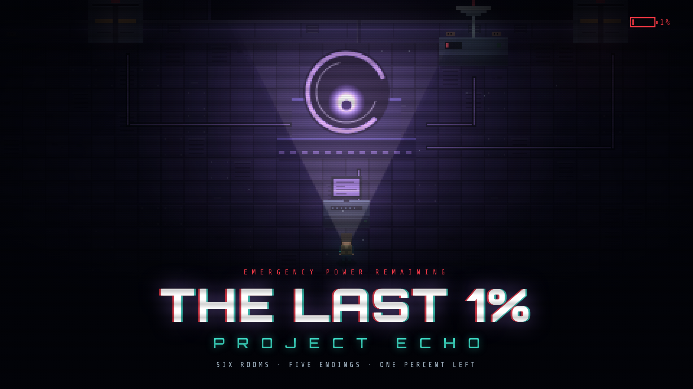
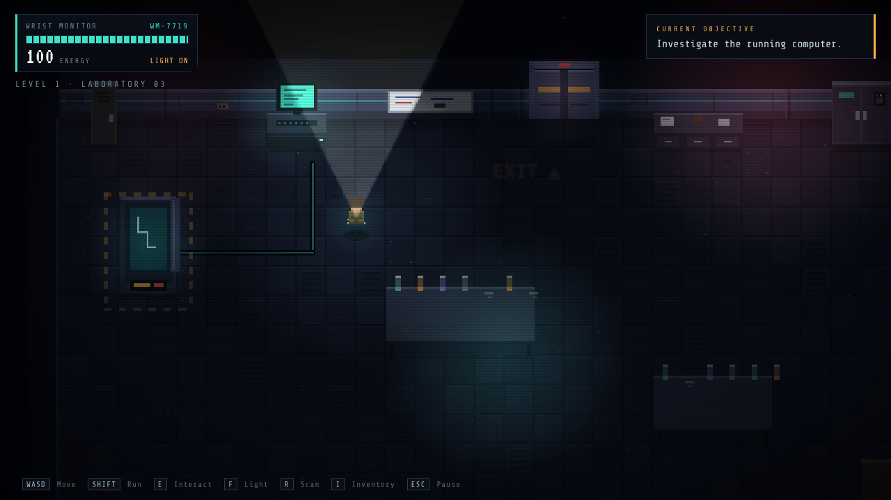
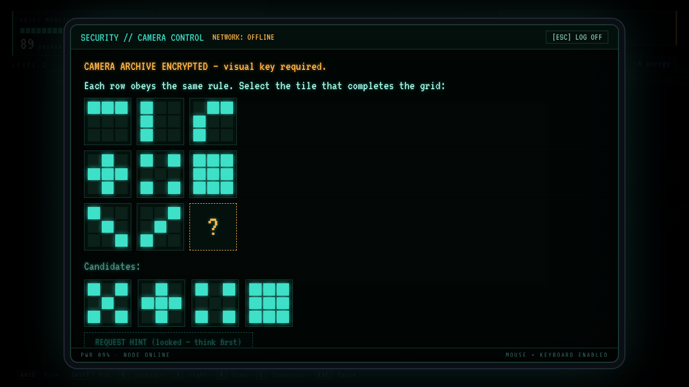
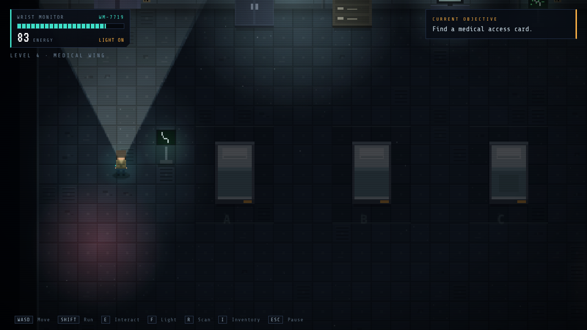
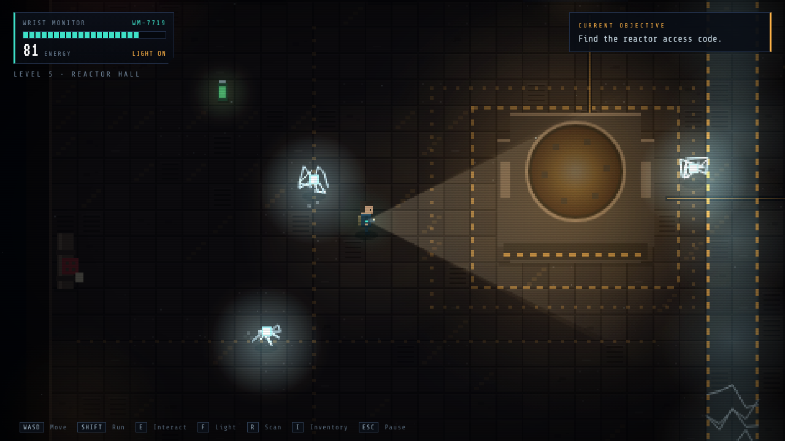
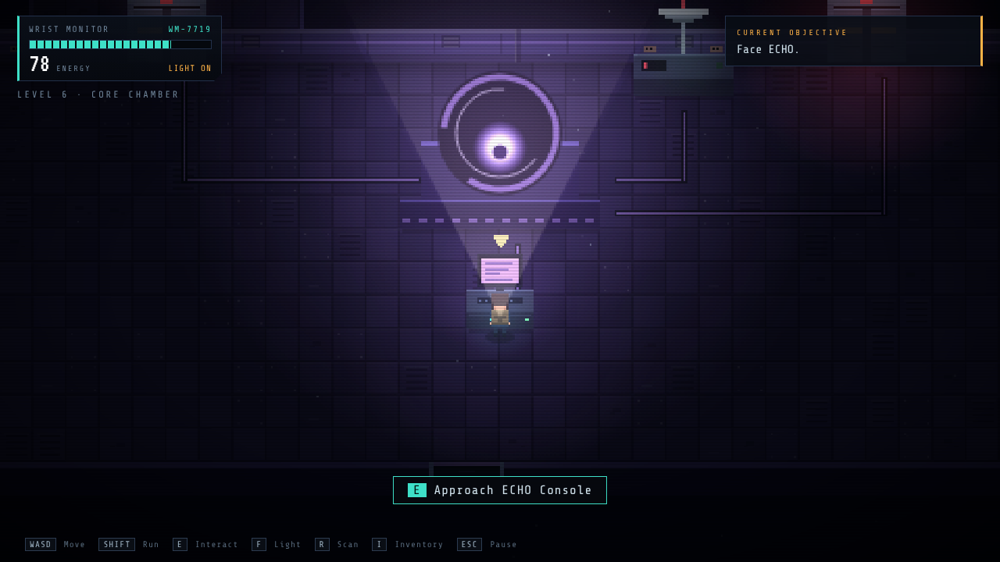

<p align="center">
  
</p>

<h1 align="center">The Last 1%: Project ECHO</h1>

<p align="center">
  <em>A 2D top-down puzzle and survival adventure, set in a research facility running on its last one percent of power.</em>
</p>

<p align="center">
  
  
  
  
</p>

<h3 align="center">
  <a href="https://samz6293.github.io/project-echo/">▶ Play it in your browser</a>
</h3>

---

## About the game

You wake up alone in a cracked stasis pod. The lab is dark, everyone is gone, and the
facility is running on emergency power.

A calm voice comes through the speakers. It calls itself **ECHO**. It knows your name, it
says it can get you out, and it needs you to be its hands.

Your job is to get from the lab down to the facility's core. On the way you search rooms, find
keys and access cards, boot old terminals and piece together what happened here. Pay attention
to the notes left behind. Not everything in this place is what it seems, and that includes the
voice helping you.

### What makes it tick

- **Energy as a resource.** Your wrist monitor's battery powers the flashlight, the scanner,
  terminals and doors. Every action costs something. When you run dry, ECHO offers to share its
  own power. You can decide whether that's a good idea.
- **Six handcrafted levels.** Starting in the laboratory and ending in the core chamber, each
  level has its own mood, hazards and secrets.
- **Terminal puzzles.** You'll solve logic and pattern puzzles on the facility's computers,
  work a command-line shell, search databases and reroute power.
- **Choices that matter.** Who you trust, what you collect and what you decide along the way all
  shape how the story ends. There are **five different endings** to find.
- **Atmosphere.** Pixel art, dynamic lighting, a flashlight cone, a scan pulse that picks out
  hidden items, and music and sound effects synthesized live in the browser.

## Screenshots

<table>
  <tr>
    <td></td>
    <td></td>
  </tr>
  <tr>
    <td align="center"><sub>Level 1: The laboratory</sub></td>
    <td align="center"><sub>Cracking a terminal puzzle</sub></td>
  </tr>
  <tr>
    <td></td>
    <td></td>
  </tr>
  <tr>
    <td align="center"><sub>The medical wing</sub></td>
    <td align="center"><sub>The reactor hall</sub></td>
  </tr>
  <tr>
    <td colspan="2"></td>
  </tr>
  <tr>
    <td colspan="2" align="center"><sub>The core chamber</sub></td>
  </tr>
</table>

## Getting started

### Play online

The game is hosted on GitHub Pages. To play, open
**[samz6293.github.io/project-echo](https://samz6293.github.io/project-echo/)** in a desktop browser.
Progress is saved in your browser automatically, so you can close the tab and continue later.

## Controls

| Key            | Action            |
| -------------- | ----------------- |
| `W A S D` / Arrows | Move          |
| `Shift`        | Run               |
| `E`            | Interact          |
| `F`            | Toggle flashlight |
| `R`            | Scan the room     |
| `I`            | Open backpack     |
| `Esc`          | Pause             |

Terminal puzzles accept both mouse and keyboard input.

## Project structure

```
project-echo/
├── index.html        # Entry point
├── css/
│   └── style.css     # HUD, menus, terminals and overlays
├── js/
│   ├── core.js       # Game state, save system, items, clues, energy
│   ├── audio.js      # Synthesized music and sound effects (Web Audio API)
│   ├── rooms.js      # Room data: floors, objects, lights, hazards
│   ├── render.js     # Pixel-art sprites, lighting and visual effects
│   ├── ui.js         # HUD, dialogue, terminal shell, keypad, inventory, menus
│   ├── puzzles.js    # The terminal puzzles
│   ├── story.js      # Interactions, decisions, objectives and endings
│   └── main.js       # Game loop, input, player movement, collision
└── assets/           # Screenshots used in this README
```

## Built with

- **HTML5 Canvas** for rendering
- **Vanilla JavaScript**, with no frameworks or libraries
- **Web Audio API** for all music and sound, generated in code with no audio files
- **localStorage** for save data
- [Google Fonts](https://fonts.google.com/), which fall back to the system monospace font when offline

## Credits

Made by **Sameer** and **Tibbian** as the final project for our **Algorithms** course.

We vibe coded the game with [Claude](https://claude.ai). We handled the ideas, story, design and
direction, and Claude helped turn them into code.
